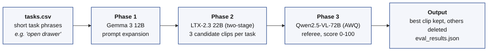
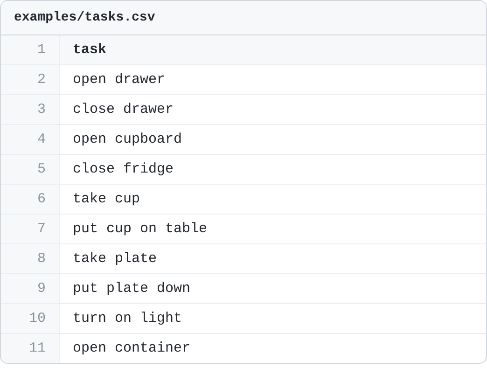
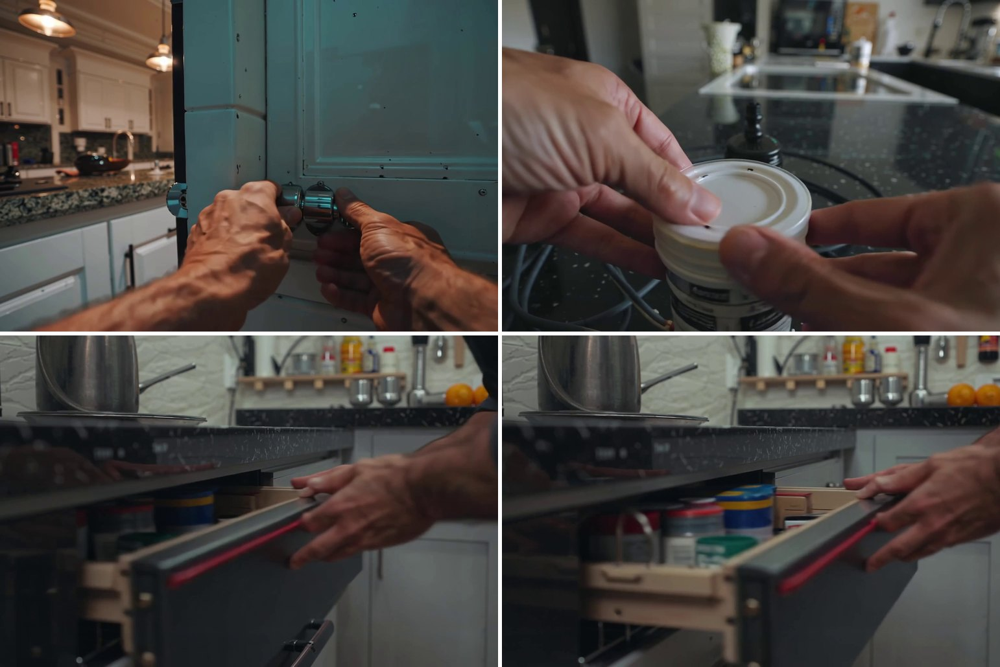

# EgoSynth

**Synthetic egocentric (first-person) manipulation videos for VLA pretraining: LLM prompt expansion, text-to-video generation, and VLM quality filtering.**



## Overview

Vision-Language-Action (VLA) models learn dexterous manipulation from large amounts of egocentric human video, and recording that video is slow and expensive. Scaling results such as NVIDIA's EgoScale study report that VLA validation loss falls roughly log-linearly with the hours of egocentric data used for pretraining, so data volume is the bottleneck.

EgoSynth tests the alternative: *generate* the data. Given a CSV of short task phrases (`open drawer`, `put cup on table`), it produces one curated first-person clip per task, with no human recording and no camera hardware.

It was built during a research internship at the AI and Robotics Research Lab, UM6P College of Computing (June to July 2026), after comparing it against two exocentric-to-egocentric approaches (EgoX and TrajectoryCrafter) that proved too slow or too unstable. See [Project context](#project-context-and-status).

## How it works: "generate 3, keep 1"

| Phase | Model | What it does |
|---|---|---|
| 1. Prompt expansion | Gemma 3 12B (instruct) | Expands each short phrase into a detailed, cinematic first-person prompt (hand movement, lighting, textures, physics). Saved to `prompt_info.json`. |
| 2. Video synthesis | LTX-2.3 22B, two-stage, with distilled LoRA (strength 0.8) and x2 spatial upscaler | Renders 3 candidate clips per task (different seeds), 121 frames each. |
| 3. Quality referee | Qwen2.5-VL-72B (AWQ) | Watches each candidate (sampled at 2 FPS), critiques hand anatomy, contact physics, temporal consistency and lighting, then outputs `Score: [0-100]`. The best candidate is kept and the others are deleted (use `--keep_all` to keep them). |

Models are loaded one at a time and unloaded between phases, so the whole loop runs on a **single GPU** (developed on an NVIDIA A100 80 GB).

Scores the referee does not state clearly are never replaced by a default value: they are recorded under `unparsed` in `eval_results.json` and treated as failures. If none of a task's candidates has a readable score, nothing is deleted for that task.

## Example: from short prompts to first-person clips

**Input.** A CSV with one short task phrase per row ([`examples/tasks.csv`](examples/tasks.csv)):

<p align="center">
  
</p>

**Output.** One curated egocentric clip per task. Frames from clips generated by the pipeline during the project (drawer, door handle, container lid):

<p align="center">
  
</p>

These frames are representative examples chosen for illustration. Generated hands can still show artifacts (see [Limitations](#limitations)), which is why every candidate passes through the referee.

## Requirements

- Linux with an NVIDIA GPU of about 80 GB (developed on an A100 80 GB)
- Python 3.12 or newer and a recent CUDA / PyTorch stack, as required by [LTX-2](https://github.com/Lightricks/LTX-2)
- A Hugging Face account that has accepted the Gemma license (the Gemma weights are gated)
- Tens of GB of disk per model for the weights

## Installation

1. **Set up the LTX-2 environment** (this provides `ltx_pipelines`):
   ```bash
   git clone https://github.com/Lightricks/LTX-2.git
   cd LTX-2
   uv sync
   source .venv/bin/activate
   cd ..
   ```

2. **Clone EgoSynth and install its dependencies into the same environment:**
   ```bash
   git clone https://github.com/Youssef-AOUZAH/EgoSynth.git
   cd EgoSynth
   uv pip install -r requirements.txt     # or: pip install -r requirements.txt
   ```

3. **Download the weights.** Authenticate first with `hf auth login`.
   ```bash
   # LTX-2.3 (main model, distilled LoRA, x2 spatial upscaler)
   hf download Lightricks/LTX-2.3 \
       ltx-2.3-22b-dev.safetensors \
       ltx-2.3-22b-distilled-lora-384.safetensors \
       ltx-2.3-spatial-upscaler-x2-1.1.safetensors \
       --local-dir checkpoints

   # Gemma 3 12B (prompt expansion and LTX text encoder)
   hf download google/gemma-3-12b-it-qat-q4_0-unquantized --local-dir models/gemma-3-12b
   ```
   The Qwen2.5-VL-72B-Instruct-AWQ referee is downloaded automatically on first use. If a file name above has changed on the Hugging Face repo, check its *Files* tab and adjust the constants at the top of `generate_dataset.py`.

## Usage

Prepare a CSV with a header row and one task per row (see [`examples/tasks.csv`](examples/tasks.csv)). The column is named `task` or `prompt`; otherwise the first column is used.

**Check your setup without a GPU:**
```bash
python generate_dataset.py --csv_file examples/tasks.csv --run_local --dry_run
```

**Run locally:**
```bash
python generate_dataset.py --csv_file examples/tasks.csv --output_dir my_dataset --run_local
```

**Submit to a Slurm cluster** (the script writes `auto_submit.slurm` and calls `sbatch`):
```bash
python generate_dataset.py --csv_file tasks.csv --output_dir my_dataset \
    --slurm_account my-account --slurm_partition gpu \
    --python /path/to/env/bin/python \
    --slurm_setup "module load Anaconda3; source activate egosynth"
```
Use `--dry_run` (without `--run_local`) to print the generated Slurm script without submitting it.

**Notebook:** `%run generate_dataset.py` runs with default arguments (Jupyter's hidden arguments are ignored).

The run is resumable: tasks that already have a `prompt_info.json`, valid candidate clips, or an `eval_results.json` are skipped.

### Output layout

```text
my_dataset/
└── task_000/
    ├── prompt_info.json     # raw phrase and expanded prompt
    ├── video_seed_2.mp4     # the winning candidate (the others are deleted)
    └── eval_results.json    # winner, scores, referee critiques, unparsed replies
```

### Options

| Option | Default | Description |
|---|---|---|
| `--csv_file` | `tasks.csv` | Input task phrases |
| `--output_dir` | `generated_dataset` | Output directory |
| `-n`, `--chunk_size` | `10` | Tasks per end-to-end chunk (models reload per chunk, so larger means fewer reloads) |
| `--num_seeds` | `3` | Candidate clips per task (1 to 9) |
| `--num_frames` | `121` | Frames per clip |
| `--keep_all` | off | Keep all candidates instead of deleting the lower-scoring ones |
| `--gemma_path` | `models/gemma-3-12b` | Gemma 3 12B directory or HF id (env `GEMMA_PATH`) |
| `--ltx_dir` | `checkpoints` | LTX-2.3 weights directory (env `LTX_CHECKPOINT_DIR`) |
| `--qwen_path` | `Qwen/Qwen2.5-VL-72B-Instruct-AWQ` | Referee model (env `QWEN_MODEL_PATH`) |
| `--offline` | off | Set `HF_HUB_OFFLINE=1` for compute nodes without internet |
| `--run_local` / `--dry_run` | off | Run directly instead of submitting to Slurm / print the plan and exit |
| `--slurm_*`, `--python` | see `--help` | Slurm account, partition, QoS, time, memory, CPUs, setup commands, Python executable |

### Standalone referee

Score any folder of clips with the same referee (also writes `evaluation_results.json`):
```bash
python scripts/evaluate_video.py --video_dir path/to/videos --threshold 85 --sort
```

## Tests

```bash
python -m unittest discover -s tests -v
```
The tests cover the score parser, which is the part of the referee that decides which clip is kept. The GPU phases are not covered by automated tests.

## Project context and status

- **Why this approach.** Two exocentric-to-egocentric pipelines were evaluated first. EgoX gave good visual fidelity but needed about 20 minutes of compute per 1.6 s clip, and extrapolating from small benchmarks made it impractical at scale. TrajectoryCrafter failed because iterative camera redirection accumulated diffusion errors. Text-to-video generation with a VLM filter was the only approach that scaled.
- **Model size matters.** In early tests a 13B LTX model often defaulted to a chest-level view instead of a head-mounted one, whereas the 22B LTX-2.3 model followed first-person constraints much more reliably.
- **What was run.** The pipeline was run on a batch of about 300 task phrases (3 candidates each) on a single A100 80 GB node.
- **Not included.** Downstream VLA pretraining (SmolVLA / SO-101) and its simulation evaluation are future work and are not part of this repository. The referee is a VLM, not a human ground truth, and its scores have not been validated against human judgments here.

## Limitations

- Generated hands can still show anatomical artifacts (extra or morphed fingers) or object clipping. The referee reduces but does not eliminate them.
- Clips are short (121 frames) and visually realistic but carry no robot action labels, so they suit visual pretraining and latent-action methods rather than direct imitation learning.
- Results depend on the exact model versions and prompts. Re-tuning the referee prompt was needed to make it detect structural failures reliably.

## Reproducibility note

[`scripts/legacy_batch_pipeline.py`](scripts/legacy_batch_pipeline.py) is the original hard-coded script used for the first 300-task batch. It differs from `generate_dataset.py` in its expansion prompt (kitchen-specific), a shorter referee prompt, and environment-specific compatibility patches. `generate_dataset.py` is the cleaned, configurable version of the same three-stage design.

## References

- EgoScale: Scaling Dexterous Manipulation with Diverse Egocentric Human Data (NVIDIA Research), [arXiv:2602.16710](https://arxiv.org/abs/2602.16710)
- EPIC-KITCHENS-100, [dataset annotations](https://github.com/epic-kitchens/epic-kitchens-100-annotations) (source of the task-phrase style)
- [LTX-2](https://github.com/Lightricks/LTX-2) (Lightricks), [Gemma 3](https://huggingface.co/google/gemma-3-12b-it) (Google), [Qwen2.5-VL](https://huggingface.co/Qwen/Qwen2.5-VL-72B-Instruct-AWQ) (Alibaba)

## License

Code is released under the [MIT License](LICENSE). The model weights are **not** included and are governed by their own licenses (LTX-2 Community License, Gemma Terms of Use, Qwen license). Check them before using generated data commercially.

## Author

Youssef AOUZAH, UM6P College of Computing, Rabat, with extensive guidance and help from professors Adil Bahaj, Daniel Bonilla Licea, and Mounir Ghogho.
